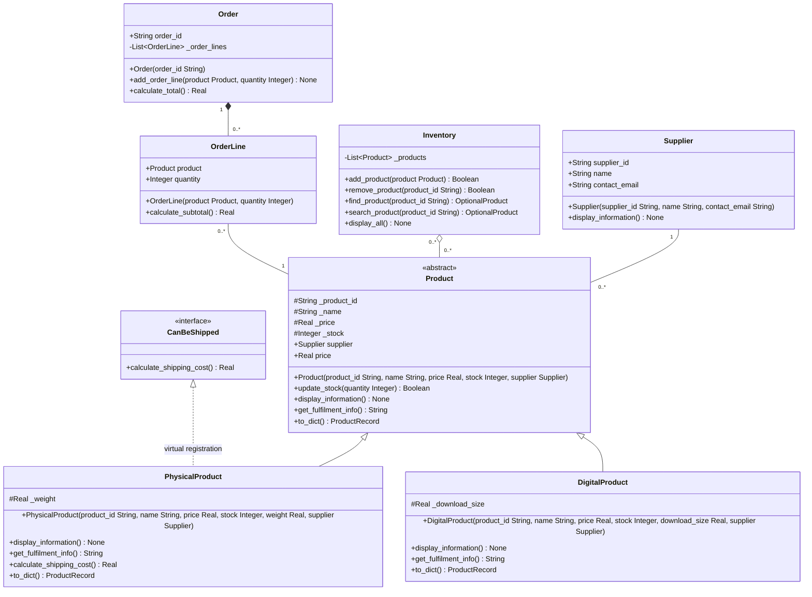

# PRD — INF1103 Lab 8 Inventory Management System

## Outcome and scope

Extend the uploaded Week 7 Python inventory CLI to demonstrate object relationships, type-driven design, Liskov substitution and polymorphism. Preserve existing menu, stock, shipping and JSON behavior while integrating the new model. The requirements below follow `INF1103_Week10_Lab08_V2.docx`. The [codebase map](CODEBASE_MAP_Lab8.md) records the verified baseline. The [tracker](Lab8_Project_Plan_and_Progress.md) contains the staged learning and delivery workflow.

## Requirements and acceptance criteria

| ID | Handout section | Requirement and observable acceptance |
|---|---|---|
| LAB-01 | 1 | Before coding, explain association, aggregation and composition in terms of collaboration, whole–part ownership and lifecycle. Apply the question “What happens to the part when the whole goes away?” to all three pairs. |
| LAB-02 | 2 | Add Supplier with unique `supplier_id`, `name`, `contact_email` and `display_information()`. Each Product accepts and retains one independently created, typed Supplier object. Pass it through both subtype constructors via `super()`. Demonstrate a shared supplier through both products and record the `del supplier` experiment. |
| LAB-03 | 3 | Inventory holds `list[Product]` and exposes typed `add_product(product: Product)`, `remove_product(product_id: str)`, `find_product(product_id: str) -> Product \| None`. Create a concrete Product before Inventory A, add it, predict and test its removal, use it after removal and add the same instance to Inventory B. Verify missing lookup and preserved duplicate behavior. |
| LAB-04 | 4 | Order has unique `order_id` and typed OrderLine collection. `add_order_line(product: Product, quantity: int) -> None` creates and manages each line inside Order. Each line references a Product, stores an integer quantity and returns price × quantity from `calculate_subtotal() -> float`. Order sums delegated subtotals in `calculate_total() -> float`. Display at least two lines, verify the total, compare identities across two orders and exercise line removal through Order or remove the Order from the scenario. Lines belong to exactly one Order and cannot be transferred through the Order API. Products retain their independent lifecycle. |
| LAB-05 | 5 | Design UML types before coding. Annotate object references, collection element types, parameters and returns, including `None` and optional lookup. Choose specific types and avoid using `Any` as a shortcut. Check UML against Python before moving to LSP. Explain that annotations communicate intent and support tools. Python does not automatically enforce them at runtime. |
| LAB-06 | 6 | Run `show_product_details(product: Product) -> None` unchanged for both concrete classes, calling display and printing fulfilment. Exercise both through normal inventory operations. Identify a Product expectation and explain how both preserve it. Write the handout's 2–3 sentence diagnosis of the proposed digital `update_stock` that raises `NotImplementedError`, including what to change and why. Review accepted inputs, return values and meanings. Avoid subtype checks as a workaround. |
| LAB-07 | 7 | Store both subtypes in one inventory. Use one loop through Product references to call display and fulfilment, allowing each override to run. Record the fulfilment prediction before executing. Verify both specialised behaviors and explain how polymorphism depends on safe substitution. |
| LAB-08 | 8 | Submit complete typed UML for Week 7 and Lab 8 classes with correct association, aggregation, composition and inheritance notation. Include attributes, parameter types, return types and multiplicities. If AI helps with the diagram, check each relationship against Section 1 and note one suggestion accepted and one changed. |
| LAB-09 | 9 | Verify relationships, reference identity, totals, types, LSP and polymorphic output using tests. Review class responsibilities and compare the implementation and diagram. Rerun Week 7 regression checks, including CLI and persistence paths affected by changes. |
| LAB-10 | 11 | Inspect Git status, stage reviewed changes with the prescribed `git add .`, commit meaningfully, push to the course remote and review `git log`. Run program and tests using established Docker workflow and capture Git and Docker evidence. Obtain explicit approval for any assistant staging/commit and separately for push. |

## Proposed UML starting point

This is a design draft. Synchronize names, types, visibility and multiplicities with the approved implementation and export the final diagram for submission.

- `OptionalProduct` represents Product [0..1] or Python `Product | None`. `ProductRecord` denotes the serialized record shape to specify during the approved type review.
- Generalization points a hollow triangle at Product. A solid line marks each association. The hollow diamond is at Inventory and the filled diamond is at Order. The dashed interface edge represents Week 7 virtual registration.
- The proposed Inventory multiplicity permits sharing, consistent with the current collection behavior. The transfer test removes the reference from A before adding it to B. If the approved design enforces exclusive membership, change the Inventory end to `0..1`.
- Proposed choices include read-only price access, a boolean removal result, internal OrderLine storage, compatible lookup naming and a documented supplier migration for typed Week 7 records. Decide ID enforcement, supplier reuse, quantity validation and line access/removal details before editing. Keep order checkout, order persistence and expanded menus outside the default scope.

## Definition of done

Submit updated Python source and final UML, evidence of type hints, tests or screenshots demonstrating the relationships and LSP, mixed-product polymorphism evidence, Git and Docker screenshots, and a Word document with all four Predict First notes. For each note include the prediction recorded before execution, actual result and a correction or explanation if they differ. Section 10 reflection is optional. The requirements table, decisions and definition-of-done structure follow the EventWise PRD example.
