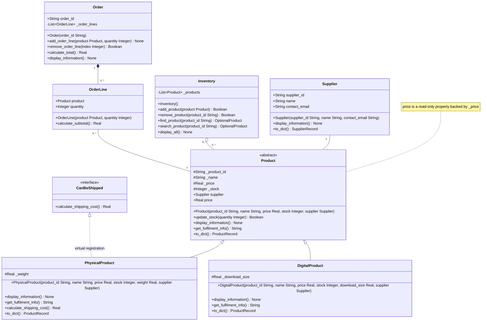

# Lab 8 typed relationship design

This design adapts the [PRD draft](Background/PRD_Lab8.md) for the active `Week8/` application. Supplier association, Inventory lookup/removal and Order composition are implemented and tested. All four official demonstrations have now run after proposed predictions were recorded; see `Lab8_Predict_First_Notes.md`. The source-aligned diagram has been exported and visually checked; later model changes require a fresh alignment/export review.

## Relationships and ownership

| Relationship | Meaning and multiplicities |
|---|---|
| PhysicalProduct and DigitalProduct inherit Product | Each concrete class is a Product. The hollow triangle points to Product. |
| PhysicalProduct implements CanBeShipped virtually | Preserve the existing ABC registration; do not imply that registration supplies methods. |
| Supplier associated with Product | Each Product references one Supplier; a Supplier may supply zero or more Products. Neither is an owned part of the other. |
| Inventory aggregates Product | Each Inventory groups zero or more Products. A Product may belong to zero or more Inventories, preserving the existing collection's allowance for shared references. Inventory does not own Product lifetimes. |
| Order composed of OrderLine | Each Order manages zero or more lines; each line belongs to exactly one Order. Order creates its lines internally and provides no API to transfer or share them between Orders. |
| OrderLine associated with Product | Each line references one independent Product; a Product may be referenced by zero or more lines. This reference does not give the line ownership of the Product. |

Multiplicity at an endpoint counts instances at that endpoint for one object at the opposite endpoint. The hollow diamond marks the aggregating whole; the filled diamond marks the composing whole. Python references and garbage collection do not automatically enforce the intended ownership rules.

## Source-aligned typed class diagram

## Types and preserved contracts

- UML `String`, `Real`, `Integer` and `Boolean` correspond to Python `str`, `float`, `int` and `bool`. `None` indicates no returned value. Python constructors will use `-> None`; UML constructor entries name the class being constructed.
- `OptionalProduct` is shorthand for zero or one Product result, expressed as `Product | None` in Python. Callers must handle the missing result before invoking Product methods.
- `List<Product>` and `List<OrderLine>` describe collection element types. `list[Product]` supports both existing concrete Product types through their common operations.
- Implemented: `add_product(...) -> bool` preserves duplicate-ID rejection. `find_product(...) -> Product | None` contains the lookup loop; `search_product(...)` delegates to it for compatibility.
- Preserve `update_stock(...) -> bool`: a nonnegative quantity sets absolute stock and succeeds; a negative quantity leaves stock unchanged and returns false.
- Implemented: `remove_product(...) -> bool` returns true when an entry was removed, false for a missing ID. Read-only `price` access uses `_price` as its source of truth.
- `SupplierRecord` is a Python TypedDict containing string fields `supplier_id`, `name` and `contact_email`. `ProductRecord` is a TypedDict with `id: str`, `name: str`, `price: float`, `stock: int` and `supplier: SupplierRecord`. Its subtype-specific fields `type: str`, `weight: float` and `download_size: float` are `NotRequired` because the common Product serializer builds the record before each subtype extends it. These are record descriptions, not domain classes.
- Type hints communicate intent and support analysis tools. They do not automatically validate runtime values or enforce ownership.

## Decisions still required before implementation

| Milestone | Open decisions |
|---|---|
| Supplier association | Milestone 1 decisions below; the official deletion demonstration remains deferred until the student records a prediction. |
| Inventory aggregation | Typed lookup/removal implemented; lookup delegation and boolean meanings recorded above. Shared-membership allowance unchanged. Official PF-2 demonstration deferred. |
| Order composition | Milestone 3 approved design below; PF-3 identity demonstration remains deferred. |
| Type and UML review | Source signatures, attributes, serialized shapes and multiplicities reviewed in Milestone 4. Final diagram export and student-authored AI reflection remain submission work. |

Order checkout, order persistence and additional menu actions remain outside the proposed scope. All four official Predict First answers and the student's AI-diagram reflection (one suggestion accepted and one changed) remain to be recorded in the student's own words. This design contains no demonstration output.

## Milestone 0 review

On 13 November 2026, the student distinguished association, aggregation and composition, interpreted optional membership and empty collections, and explained why a Product-typed collection supports both subtypes. After clarification, the student selected checking `result is not None` before using an optional lookup result. This establishes the introductory design understanding; implementation and runtime evidence remain pending.

## Milestone 1 implementation decisions

- Supplier is constructed independently and injected as the final argument into Product and both subtype constructors. Product retains `supplier: Supplier`; common display includes supplier information.
- Supplier IDs and names must be nonempty strings; email is a string and may be empty to represent unavailable contact information. The reserved ID `UNKNOWN` has name `Unknown supplier` and an empty email; the CLI cannot create a real supplier using that ID.
- Missing supplier fields in otherwise typed Week 7 JSON records map to this explicitly labelled placeholder. Loading does not rewrite the input file. Saving adds nested supplier details; subsequent loading reuses one Supplier per ID within that load. Conflicting details for the same ID are rejected without modifying the file. Explicitly malformed supplier data is rejected rather than treated as missing.
- CLI add asks for supplier details after validating the product's numeric fields. An existing supplier ID reuses the object referenced by a current inventory product; a new ID asks for name and contact email. No global registry is introduced: direct model callers are responsible for consistent IDs, and CLI/load enforce reuse within their inventory/session.
- ProductRecord and SupplierRecord describe the serialized shape using standard-library TypedDict and NotRequired, compatible with the Dockerfile's Python 3.11.
- Menu options, stock semantics and shipping behavior stay unchanged. The sample JSON remains unchanged; supplier fields are added only when the user saves.

## Milestone 2 implementation review

Inventory holds `list[Product]`; constructor, add, find, search, remove and display methods have type annotations. The diagram's Inventory signatures now match the source. No transfer method or extra menu option is introduced: the existing add/remove API is the intended interface. Transfer evidence remains deferred until PF-2 is recorded.

## Milestone 3 approved design

- `Product.price` is a read-only property returning the current `_price` as a float. No second price field is stored. Order totals use current prices, not historical snapshots.
- `OrderLine` stores `product: Product` and `quantity: int`. Construction rejects zero, negative, non-integer and boolean quantities with ValueError. `calculate_subtotal() -> float` multiplies product price by quantity.
- `Order` validates a nonempty string ID. Callers supply unique IDs; no global registry is introduced. Its `_order_lines: list[OrderLine]` is internal storage. `add_order_line(product: Product, quantity: int) -> None` creates each line internally; no method accepts a prebuilt line or transfers one.
- `remove_order_line(index: int) -> bool` uses a zero-based index. It returns false for an out-of-range index, including negative indexes, and true for a removed entry. Display shows each line's zero-based index, product information, quantity and subtotal, followed by the total.
- `calculate_total() -> float` delegates to each line's subtotal method and starts from 0.0 for an empty order. Adding or removing lines does not change stock. Line inspection for tests uses the internal list; no public mutable collection is added.
- These ownership rules describe the supported API. Python does not prevent deliberate external access to underscore-prefixed storage or independently constructing an OrderLine.
- Orders are not persisted and no CLI option is added. Focused tests cover one-order behavior; the official two-order identity experiment remains deferred until PF-3 is recorded.
- Verification: 11 focused Order tests passed. Full Week7/Week8 regression discovered 67 tests: 66 passed, 1 PF-2 test skipped. The Order signatures above match the implemented API; final whole-system type/UML review remains Milestone 4.

## Milestone 4 type and UML review

All 39 authored functions/methods in `main.py` have annotated non-self parameters and return values. Product's common fields and both subtype-specific fields now have explicit annotations. Supplier, Inventory, Order and OrderLine references and collections already carried their specific types. No `Any` is used. Type hints communicate the intended contract; they do not validate all runtime values.

| Source area | Reviewed types |
|---|---|
| Product | `_product_id: str`, `_name: str`, `_price: float`, `_stock: int`, `supplier: Supplier`; read-only `price -> float`; stock update returns bool; display returns None; fulfilment returns str. |
| Subtypes and shipping interface | `_weight: float`, `_download_size: float`; display returns None; fulfilment returns str; shipping returns float. Existing virtual ABC registration is preserved. |
| Inventory | `list[Product]`; add/remove return bool; find/search return Product or None; constructor/display return None. |
| Orders | `order_id: str`, `list[OrderLine]`, `product: Product`, `quantity: int`; subtotal/total return float; add/display return None; indexed removal returns bool. |
| Persistence | `load_inventory() -> Inventory`, `save_inventory(inventory: Inventory) -> None`, supplier cache `dict[str, Supplier]`, serialized collection `list[ProductRecord]`. |
| CLI | All inventory handlers accept Inventory and return None; `print_menu()` and `main()` return None. Local optional supplier is `Supplier | None`; constructed product variables use the Product base type. |

The two TypedDict record shapes are defined in the types section above. They describe serializer output, not an automatic validator for untrusted JSON: existing explicit loading checks still apply. Legacy typed input may omit supplier data as documented in Milestone 1. Optional subtype fields allow the common serializer to be extended by either subtype.

Reviewed all diagram attributes, methods and relationship endpoints against source. Association edges have no ownership diamonds; Inventory uses a hollow diamond and permits shared membership; Order uses a filled diamond and each line has exactly one intended owner. `OptionalProduct` means a Product return multiplicity of 0..1. The read-only price note distinguishes a property from a second stored price field. Free CLI/persistence functions are described above rather than represented as domain classes.

Verification on 13 November 2026: annotation coverage and runtime hint resolution passed; stripping annotations produced the same executable syntax tree as the preceding commit. Full regression: 66 passed, 1 PF-2 skip. No static type checker was installed or run, no new dependency was added, and the Mermaid diagram has not been exported or visually verified for submission. The student's accepted/changed AI suggestions remain to be recorded in their own words.

## Submission diagram exports — 13 November 2026

- [Editable Mermaid source](uml/Lab8_Class_Diagram.mmd), extracted directly from the diagram block above and checked for exact text equality.
- [Scalable SVG](uml/Lab8_Class_Diagram.svg), parsed as valid XML and checked for all eight domain/interface classes.
- [High-resolution PNG](uml/Lab8_Class_Diagram.png), 4500 × 2564 pixels, visually inspected for unclipped signatures, readable types, inheritance triangles, virtual interface registration, ownership diamonds and endpoint multiplicities.

Rendering used a disposable `ghcr.io/mermaid-js/mermaid-cli/mermaid-cli` container, image digest `sha256:18938e53497376d524e04b1fc0bf7b6d61a491ce9ff7032bb2855d57155acb10`. The container mounted only `Week8/uml` at `/data`. Its supported CLI options generated SVG with `-i /data/Lab8_Class_Diagram.mmd -o /data/Lab8_Class_Diagram.svg -b white` and PNG with `-i /data/Lab8_Class_Diagram.mmd -o /data/Lab8_Class_Diagram.png -b white --size 4500`. No renderer dependency was installed in the application.

This completes export/visual review and supersedes the earlier pending-export notes. It does not supply the student's AI-use reflection, official predictions, or runtime demonstration evidence. `OptionalProduct` denotes Product [0..1] (`Product | None`); ProductRecord/SupplierRecord are serialized record shapes defined above. Submit this design explanation alongside the diagram when those labels need context.

## Final evidence update

At the user's request, proposed predictions, observations, LSP diagnosis and UML review notes were prepared in `Lab8_Predict_First_Notes.md` and the matching visually checked Word document. The prediction file was created before the remaining official demonstrations ran in this session. These notes are available for user review and are not represented as independent predictions made earlier. `lab8_demonstrations.py` and `evidence/lab8_demonstrations.txt` provide the actual runtime evidence. All enabled tests pass: host 76/76 and Docker Week8 60/60, with no skips. This supersedes the earlier deferred-evidence notes without altering the diagram's model design.
