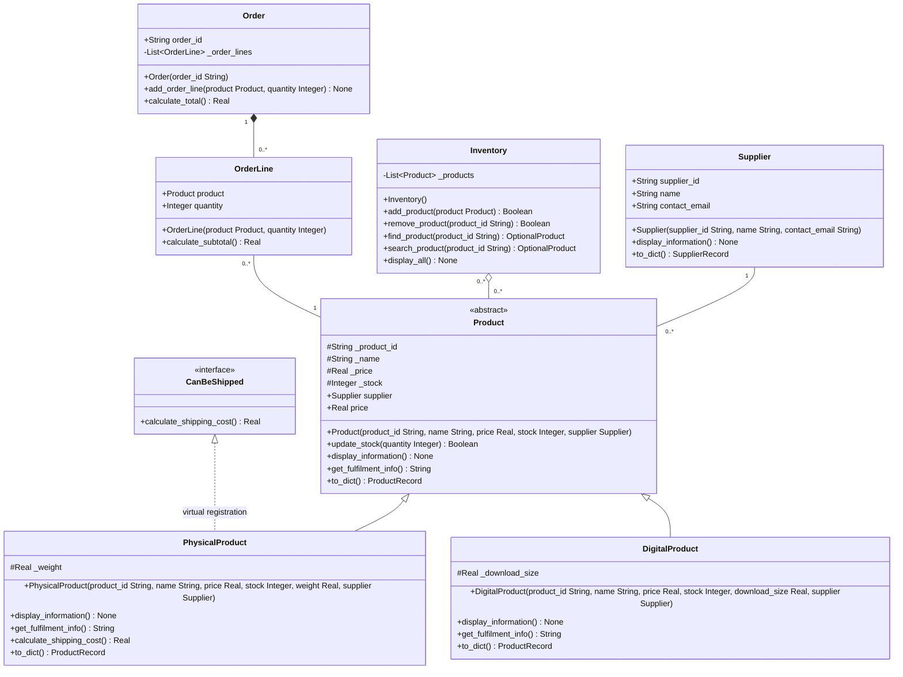

# Lab 8 typed relationship design

This provisional design adapts the [PRD draft](Background/PRD_Lab8.md) for the active `Week8/` application. Supplier association is implemented and tested in Milestone 1; its official deletion demonstration remains deferred. Inventory removal and Order classes remain proposed. Each implementation milestone still needs a focused proposal and explicit approval. The final submission diagram must be checked against the finished source and exported legibly.

## Relationships and ownership

| Relationship | Meaning and multiplicities |
|---|---|
| PhysicalProduct and DigitalProduct inherit Product | Each concrete class is a Product. The hollow triangle points to Product. |
| PhysicalProduct implements CanBeShipped virtually | Preserve the existing ABC registration; do not imply that registration supplies methods. |
| Supplier associated with Product | Each Product references one Supplier; a Supplier may supply zero or more Products. Neither is an owned part of the other. |
| Inventory aggregates Product | Each Inventory groups zero or more Products. A Product may belong to zero or more Inventories, preserving the existing collection's allowance for shared references. Inventory does not own Product lifetimes. |
| Order composed of OrderLine | Each Order manages zero or more lines; each line belongs to exactly one Order. Order creates its lines internally and provides no API to transfer or share them between Orders. |
| OrderLine associated with Product | Each line references one independent Product; a Product may be referenced by zero or more lines. This reference does not give the line ownership of the Product. |

Multiplicity at an endpoint counts instances at that endpoint for one object at the opposite endpoint. The hollow diamond marks the aggregating whole; the filled diamond marks the composing whole. Python references and garbage collection do not automatically enforce the intended ownership rules.

## Provisional typed class diagram

## Types and preserved contracts

- UML `String`, `Real`, `Integer` and `Boolean` correspond to Python `str`, `float`, `int` and `bool`. `None` indicates no returned value. Python constructors will use `-> None`; UML constructor entries name the class being constructed.
- `OptionalProduct` is shorthand for zero or one Product result, expressed as `Product | None` in Python. Callers must handle the missing result before invoking Product methods.
- `List<Product>` and `List<OrderLine>` describe collection element types. `list[Product]` supports both existing concrete Product types through their common operations.
- Preserve `add_product(...) -> bool`, duplicate-ID rejection and `search_product(...)` compatibility. Introduce `find_product(...)` as the common lookup and retain `search_product(...)` as a wrapper when that milestone is approved.
- Preserve `update_stock(...) -> bool`: a nonnegative quantity sets absolute stock and succeeds; a negative quantity leaves stock unchanged and returns false.
- Proposed removal returns `bool`; proposed read-only `price` access uses `_price` as its source of truth. Both remain subject to implementation-milestone review.
- `SupplierRecord` is a Python TypedDict containing string fields `supplier_id`, `name` and `contact_email`. `ProductRecord` is a TypedDict with `id: str`, `name: str`, `price: float`, `stock: int` and `supplier: SupplierRecord`. Its subtype-specific fields `type: str`, `weight: float` and `download_size: float` are `NotRequired` because the common Product serializer builds the record before each subtype extends it. These are record descriptions, not domain classes.
- Type hints communicate intent and support analysis tools. They do not automatically validate runtime values or enforce ownership.

## Decisions still required before implementation

| Milestone | Open decisions |
|---|---|
| Supplier association | Milestone 1 decisions below; the official deletion demonstration remains deferred until the student records a prediction. |
| Inventory aggregation | Finalize removal's boolean meanings and lookup delegation. Preserve shared-membership allowance unless an explicitly approved change introduces exclusivity. |
| Order composition | Order ID uniqueness policy, quantity validation, read-only price access, line inspection and line-removal API or an approved scenario that removes the Order. Add any selected method signatures to the diagram before coding them. |
| Type and UML review | Resolve serialization placeholders, synchronize all signatures and attributes, check multiplicities against implementation and export the complete submission diagram. |

Order checkout, order persistence and additional menu actions remain outside the proposed scope. All four official Predict First answers and the student's AI-diagram reflection (one suggestion accepted and one changed) remain to be recorded in the student's own words. This design contains no demonstration output.

## Milestone 0 review

On 13 November 2026, the student distinguished association, aggregation and composition, interpreted optional membership and empty collections, and explained why a Product-typed collection supports both subtypes. After clarification, the student selected checking `result is not None` before using an optional lookup result. This establishes the introductory design understanding; implementation and runtime evidence remain pending.

## Milestone 1 implementation decisions

- Supplier is constructed independently and injected as the final argument into Product and both subtype constructors. Product retains `supplier: Supplier`; common display includes supplier information.
- Supplier IDs and names must be nonempty strings; email is a string and may be empty to represent unavailable contact information. The reserved ID `UNKNOWN` has name `Unknown supplier` and an empty email; the CLI cannot create a real supplier using that ID.
- Missing supplier fields in otherwise typed Week 7 JSON records map to this explicitly labelled placeholder. Loading does not rewrite the input file. Saving adds nested supplier details; subsequent loading reuses one Supplier per ID within that load. Conflicting details for the same ID are rejected without modifying the file. Explicitly malformed supplier data is rejected rather than treated as missing.
- CLI add asks for supplier details after validating the product's numeric fields. An existing supplier ID reuses the object referenced by a current inventory product; a new ID asks for name and contact email. No global registry is introduced: direct model callers are responsible for consistent IDs, and CLI/load enforce reuse within their inventory/session.
- ProductRecord and SupplierRecord describe the serialized shape using standard-library TypedDict and NotRequired, compatible with the Dockerfile's Python 3.11.
- Menu options, stock semantics and shipping behavior stay unchanged. The sample JSON remains unchanged; supplier fields are added only when the user saves.
